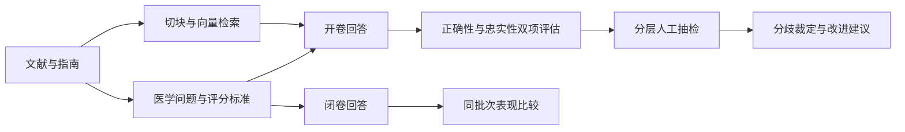

# NSCLC Evidence QA Evaluation

**面向非小细胞肺癌文献问答的多模型评测作品。** 从医学问题设计、证据检索、模型作答，到双裁判评估和人工复核，展示一套可追溯的评测流程。

**当前发布状态：人工分歧裁定已完成（post-adjudication）。** 已完成 90 题、5 个被测模型、900 条开卷/闭卷回答及 90 条分层人工抽检；75 条正确性分歧已由项目负责人逐条裁定完毕（一致 56 / 部分一致 10 / 不一致 9，其中 P0 18 条为 16 / 2 / 0）。裁定后 450 条的最终分布为**一致 334（74.2%）/ 部分一致 19（4.2%）/ 不一致 97（21.6%）**——其中**375 条是两位 AI 裁判原本就一致的推定值**（其中 74 条另经分层人工抽检且标签与双裁判一致，301 条未人工审核），**逐条人工裁定的只有这 75 条**，另有 20% 分层抽检（裁定前快照 82/90 = 91.1%）作有限支持。按（模型, 题号）去重，90 条抽检与 75 条裁定重叠 16 条，有独立人工正确性记录的共 **149/450 = 90 + 75 − 16**。本快照取代同日期的 pre-adjudication 版本。

## 先看什么

- [评测结果与局限](docs/RESULTS.md)：模型结果、检索指标、两批实验的区别。
- [方法与评分边界](docs/METHODOLOGY.md)：题型、正确性、忠实性及陷阱题规则。
- [数据字典与公开范围](docs/DATA_CARD.md)：公开文件能复算什么、不能验证什么。
- [本地重建流程](docs/REPRODUCIBILITY.md)：源码使用方式及所需材料。

## 项目流程



## 不调用模型的快速复算

需要 Python 3.10+，仅使用标准库，无需 API key 或安装模型：

```bash
python scripts/verify_public_release.py
```

该命令检查题号和模型组合、文件指纹、标签及分母，复算两位裁判的一致率、人工抽检一致率、忠实率和检索指标。新版还会复算人工裁定后的 450 条分布（334 / 19 / 97）、"谁更准"（44 vs 30 的描述性命中数与比率，不做显著性判读）、人工覆盖关系（90 条抽检 ∩ 75 条裁定 = 16 → 149/450；375 条推定值中 74 条已抽检、301 条未人工审核）与成因 18/18。**它验证已公开记录的结构与算术，不能替代对原始回答的重新阅卷。**

| 规模 / 指标 | 当前快照（post-adjudication） |
|---|---|
| 题目 | 90：可答 80、陷阱 10；其中选择题 30 |
| 问答批次 A | 5 模型 × 90 题 × 开卷/闭卷 = 900 条 |
| 正确性双裁判一致率 | 375/450 = 83.3%（κ 0.650） |
| 忠实性双裁判一致率 | 382/450 = 84.9% |
| 人工裁定（75 条分歧） | 一致 56 / 部分一致 10 / 不一致 9；P0 18 条 = 16 / 2 / 0 |
| 裁定后 450 条最终分布 | 一致 334（74.2%）/ 部分一致 19（4.2%）/ 不一致 97（21.6%） |
| "谁更准"（仅这 75 条分歧） | 一号 30/75 = 40.0%；二号 v3 44/75 = 58.7%（分歧样本内的描述性结果，未做差异检验） |
| 人工抽检（裁定前快照） | 一号 82/90 = 91.1%、二号 82/90 = 91.1%（两位裁判均 82/90 指裁定前抽检快照；应用最新人工裁定后复算为 81/90 = 90.0% 与 83/90 = 92.2%），仅适用于该抽检样本 |
| 登记证据进入 top-6 | 24/80 = 30.0% |
| 裁判判定上下文充分 | 50/80 = 62.5% |
| 陷阱题明确拒答 | 49/50 = 98% |
| 成本估算（开卷+闭卷） | 9.347 元（按原配置单价与记录 token 估算，不是账单） |

裁定后那 97 条"不一致"，由 9 条分歧人工裁定结果与 88 条双裁判一致结果组成；后者中另有 18 条接受过人工抽检。因此，按现有人工记录及最新裁定，97 条中有 27 条有人工"不一致"标签，其余 70 条尚无人工标签。上述错误类型分析仅针对 75 条分歧裁定中未获"一致"的 19 条回答，其中部分一致 10 条、不一致 9 条，**不是** 97 条的一个 19 条子集，也不代表全部错误回答的类型分布。**"疑似" ≠ "确认"**：被判"跨研究混用"的 12 条里，有 10 条人工裁定为"一致"。

这 19 条依据人工裁决理由归类的错误类型为：要素列举不完整 5 / 文献有据但未检索到 5 / 未给所问层面结论 5 / 跨研究混用 2 / 证据使用不当 1 / 核心处理建议缺失 1。

成因侧：`qa/成因待确认.csv` 16/16 = "库内存在但未进上下文"；加上抽检表中人工直接填写的 4 条"检索没给到" → **18/18 全部落在检索/上下文侧，"模型没读出证据" 0 条**。这 18 条按 14 + 4 计：16 条成因表中有 2 条不属于"该答却拒答"范围（回答不完整 / 数值错误），已单独保留在 `data/cause_confirmation_out_of_scope.jsonl`，故本分母为 14 + 4 = 18。**限定仍然成立**：裁定对象是**出题时登记的那一段**，**不等于**模型收到的片段中没有等效证据；"检索没给到"与"模型没读出"的定量拆分仍需对照实验（未做）。

这些结果描述指定题集和调用批次，不代表模型在所有医学任务上的水平。双裁判一致性不等于医学准确性；未做固定其他条件的证据补足对照实验，因此不能单因素归因于检索。**"谁更准"只表示在这批分歧条目上人工裁定的落点更常与二号 v3 一致**：在这 75 条正确性分歧记录中，一号与人工裁定一致 30 条（40.0%），二号 v3 一致 44 条（58.7%）。这是**分歧样本内的描述性结果**；**未进行考虑配对结构与同题相关性的差异检验**，不能据此推断两位裁判在全部回答上的质量排序，也不能写成"二号整体更准"。两位裁判评的是同一批回答（配对），同题跨模型回答之间还有相关性，且这 75 条是按裁判分歧筛选出来的样本，因此区间重叠一类的直观比较不能当作显著性判断（见 [RESULTS.md](docs/RESULTS.md) 脚注）。

## 工程与医学工作

- 围绕年轻医生和患者的诊断、治疗、副作用、预后问题设计题目，并绑定证据来源。
- 建立可答题与陷阱题两种评分边界，分别判断正确性与忠实性。
- 使用 bge-m3、多语言检索、引用条目过滤与降权，保存知识库和作答输入指纹。
- 保留两位 AI 裁判及项目负责人分层抽检的独立标签，记录分歧，避免把 AI 复核称为独立医生审核。
- 对 75 条正确性分歧逐条人工裁定，并单独记录成因裁定的适用范围，不覆盖原始裁判标签。
- 隔离开发记录与正式结果，校验输入版本并提供离线回归测试。

这是个人评测作品，未进行模型训练或参数微调，也不是面向患者的诊疗产品。

## 仓库结构

```text
src/          建库、出题、作答、判分与报告代码
_selftest/    精选流程测试与比较工具
scripts/      公开数据的离线复算与完整性检查
data/         90 题、900 条作答元数据、450 条双裁判标签、75 条人工裁定与成因裁定等
docs/         方法、结果、数据卡、复现和发布说明
environment/  原实验依赖快照
config.yaml   历史实验配置，包含当时的备选模型
.env.example  空白环境变量模板
```

没有打包 PDF、知识库原文、向量、模型权重、API key、完整回答、私人审计记录或旧 Git 历史。公开副本不能直接恢复原始检索上下文；获得相同文献材料后才能重建完整实验，模型服务变化也可能影响结果。

## 运行源码

请先读 [REPRODUCIBILITY.md](docs/REPRODUCIBILITY.md)。真实 API 流程会产生费用；默认推荐先执行上面的离线复算。配置中的模型 ID、价格为历史记录，不承诺今天仍可用。

## 公开与使用边界

本仓库尚未授予额外的开源许可证；公开展示不等于已授权任意再分发。参考文献权利归各自权利人。数据发布边界见 [DATA_CARD.md](docs/DATA_CARD.md)。发布步骤见 [PUBLISHING.md](docs/PUBLISHING.md)。
